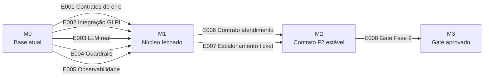

# Project Implementation Plan

**Product**: Assistente de IA para Suporte GLPI | **Created**: 2026-10-30 | **Status**: planejamento inicial | **Epics**: 8 (P1: 5, P2: 3) | **Waves**: 3

## Status das Etapas por Precedência e Dívidas de Processo

Status por etapa conforme o rastreador [docs/spec/Especificações por precedência — SP1 a SP11](../docs/legacy/spec/Especifica%C3%A7%C3%B5es%20por%20preced%C3%AAncia%20%E2%80%94%20SP1%20a%20SP11.md) e lacunas registradas no [TODO](../TODO.md):

| Etapa | Status no rastreador | Ressalva / lacuna |
|-------|----------------------|-------------------|
| SP1 — Base de alinhamento e governança | EM ANDAMENTO | documentação base consolidada; fechamento pendente |
| SP2 — Arquitetura e desenho do sistema | DONE | sem plano de execução correspondente (dívida de processo) |
| SP3 — Contratos de API | EM ANDAMENTO | plano aprovado em [docs/plan/Plano de execução — SP3](../docs/legacy/plan/Plano%20de%20execu%C3%A7%C3%A3o%20%E2%80%94%20SP3%20Contratos%20de%20API.md); faltam contratos de erro, testes negativos e alinhamento da spec 6.4 → E001 |
| SP4 — Integração com GLPI | EM ANDAMENTO | sem plano correspondente (dívida); GLPI real (solicitante, tickets similares, idempotência, auditoria) → E002 |
| SP5 — Base de conhecimento e RAG | DONE (declarado) | **resalva**: declarado sem reavaliação de evidência — reavaliar no gate → E008 |
| SP6 — IA e resposta sugerida | DONE (declarado) | **resalva**: faltam provedor LLM real, prompts versionados e confiança do modelo → E003; reavaliar → E008 |
| SP7 — Guardrails e segurança | DONE (declarado) | **resalva**: guardrails não são invocados em `auto_resolve` → E004; reavaliar → E008 |
| SP8 — Observabilidade e feedback | DONE (declarado) | **resalva**: persistência de interações/feedback inexistente → E005; reavaliar → E008 |
| SP9 — Testes e garantia de qualidade | DONE (declarado) | **resalva**: reavaliar status conforme evidência → E008 |
| SP10 — MVP da Fase 1 | DONE (declarado) | **resalva**: reavaliar status conforme evidência → E008 |
| SP11 — Evolução para Fase 2 | DONE (declarado) | **resalva**: [TODO](../TODO.md) indica status real EM ANDAMENTO (divergência com o rastreador); Fase 2 API-only → E006/E007; reabrir no gate → E008 |

> SP5–SP11 estão declarados DONE no rastreador, mas as lacunas acima e a ausência de evidência de validação correspondente indicam que os status não estão verificados. A reavaliação por evidência é trabalho do epic E008; nenhum status foi alterado por este documento.

### Dívidas de processo

| Dívida | Situação | Ação |
|--------|----------|------|
| Planos retroativos de execução de SP2 e SP4 | pendente (SP3 coberta pelo plano existente) | criar e aprovar planos antes do fechamento das etapas |
| Arquivos `.pyc` / `__pycache__` versionados | quitado — removidos do repositório no redesenho de documentação | manter remoção e evitar re-inclusão |
| `python-dotenv` ausente do `requirements.txt` | quitado — `python-dotenv==1.0.1` presente | nenhum |
| `git push` do branch `dev` para `origin` | pendente — requer autorização | executar com autorização prévia |

Proveniência: [TODO.md](../TODO.md) (roadmap e dívidas), [docs/plan/README.md](../docs/legacy/plan/README.md).

## Epic Checklist

### Wave 1 — Núcleo fechado

> Fecha as lacunas do núcleo da Fase 1: contratos de erro (plano já aprovado em docs/plan), integração GLPI real, LLM real, guardrails efetivos e persistência de observabilidade. Os cinco epics compartilham `core/schemas.py`, `core/orchestrator.py` e `interfaces/v1_agent_api.py` — execução com coordenação de integração.

- [ ] E001 [P1] [PRODUCT] {PRD:CAP-005} Contratos de erro e validação — ErrorResponse, handlers 422/400/500, testes negativos e alinhamento da spec 6.4 (`/v2/atender`)
- [ ] E002 [P1] [PRODUCT] {PRD:CAP-001,CAP-003,CAP-004} Integração real com GLPI — solicitante, tickets similares, idempotência com store local e auditoria (SP4)
- [ ] E003 [P1] [PRODUCT] {PRD:CAP-001,CAP-002} Integração LLM real — adapter Ollama/trocável por env, prompts versionados e confiança do modelo (SP6)
- [ ] E004 [P1] [PRODUCT] {PRD:CAP-006} Guardrails efetivos por perfil — PII, limiar configurável, registro de decisão e invocação em `auto_resolve` (SP7)
- [ ] E005 [P1] [PRODUCT] {PRD:CAP-004} Persistência de observabilidade — interações/feedback, `interacao_id` correlacionado e latência real (SP8)

### Wave 2 — Fase 2 API-only

> Prepara o núcleo para o portal GLPI: primeiro o contrato de atendimento do `/v2/atender` (contrato documentado antes da implementação), depois o escalonamento com criação real de ticket. Depende do núcleo fechado da Wave 1 (integração GLPI, contratos e guardrails). Restrição de ADR-0001: a Fase 2 não tem UI própria neste projeto — o portal GLPI consome a API como único canal.

- [ ] E006 [P2] [PRODUCT] [P] {PRD:CAP-007,SAD:ADR-0001} Contrato de atendimento portal — contrato estável do `/v2/atender` para o portal GLPI consumir
- [ ] E007 [P2] [PRODUCT] {PRD:CAP-007,CAP-008,SAD:ADR-0001} Escalonamento com ticket real — `ticket_id` real no escalonamento, reaproveitando o mesmo núcleo (SP11/Fase 2 API-only)

### Wave 3 — Reavaliação e gate

> Reavalia os status declarados contra evidência objetiva e executa o gate de prontidão da Fase 2 (critérios da §10.2 da especificação técnica). Não pode iniciar antes das Waves 1 e 2.

- [ ] E008 [P2] [PRODUCT] {PRD:CAP-009} Gate de prontidão Fase 2 — reavaliar SP5/SP9/SP10 por evidência e executar gate §10.2

## Dependency Diagram

Dependências explícitas: E002 fornece o cliente GLPI real de que E007 precisa para criar ticket no escalonamento; E001 fornece o `ErrorResponse` consumido por todos os endpoints; E006 formaliza o contrato que E007 implementa; E008 depende de todos os anteriores.

## Execution Wave Summary

| Wave | Epics | All Parallel? | Notes |
|------|-------|---------------|-------|
| Wave 1 — Núcleo fechado | E001, E002, E003, E004, E005 | Não | Arquivos compartilhados (`core/schemas.py`, `core/orchestrator.py`, `interfaces/v1_agent_api.py`) exigem coordenação de integração |
| Wave 2 — Fase 2 API-only | E006, E007 | Parcial | E006 é documentação de contrato ([P]); E007 depende de E006 + E002 |
| Wave 3 — Reavaliação e gate | E008 | Não | Gate exige evidência das duas ondas anteriores |

## Parallel Execution Guidance

- **Independent Epics**: E006 ([P]) pode ser executado em paralelo com qualquer outro da sua onda — toca apenas documentação de contrato. Na Wave 1 não há paralelismo livre: os cinco epics convergem nos mesmos módulos compartilhados.
- **Integration Risks**: E001 e E005 ambos alteram `interfaces/v1_agent_api.py` (handlers de erro vs. integração de feedback); E002, E003 e E004 todos alteram `core/orchestrator.py` (GLPI real, LLM real, invocação de guardrails) — integrar em ordem de contrato primeiro (E001) reduz retrabalho.
- **Shared Resource Conflicts**: `core/schemas.py` (E001 introduz `ErrorResponse`; E003 pode ajustar modelos de resposta), `main.py` (handlers globais de E001), `core/orchestrator.py` (E002/E003/E004) e a tabela/estrutura de persistência de interações (E005 consumida por E008).

## Coverage Validation

### PRD Capabilities

| Capability | Epics |
|------------|-------|
| CAP-001 Sugestão assistida ao agente | E002, E003 |
| CAP-002 Classificação de tickets | E003 |
| CAP-003 Aprovação e criação de ticket | E002 |
| CAP-004 Feedback, auditoria e observabilidade | E002, E005 |
| CAP-005 Contratos de API versionados | E001 |
| CAP-006 Guardrails por perfil | E004 |
| CAP-007 Autoatendimento Fase 2 | E006, E007 |
| CAP-008 Núcleo compartilhado entre fases | E007 |
| CAP-009 Gate de prontidão e métricas | E008 |

Todas as 9 capacidades do PRD têm ao menos um epic.

### Technical Decisions (ADR)

| ADR | Epics |
|-----|-------|
| ADR-0001 — Fase 2 via portal GLPI consumindo API própria (accepted) | E006, E007 (absorvido pelos epics de produto da Wave 2) |
| ADR-0002 — Adoção do framework SDDP substituindo o modelo SP1–SP11 (accepted) | absorvido pelo bootstrap do projeto (decisão de processo; sem epic de código) |

### Deployment & Operations (DDR)

| DDR | Epics |
|-----|-------|
| N/A — não há documento de operações (registro vazio na configuração do projeto) | — |

**Uncovered items**: nenhum item de cobertura ficou descoberto — todas as 9 capacidades do PRD e os 2 ADRs accepted do [SAD](sad.md) têm epic ou foram absorvidos. A extração operacional (DDR) é opcional e foi pulada por ausência do documento de operações.

## Shared Artifact Surface

### Shared Data Entities

| Entity | Introduced by | Consumed by |
|--------|---------------|-------------|
| `ErrorResponse` (código, mensagem, detalhes) | E001 | E005, E006, E007, todos os endpoints |
| Registro de interação (`interacao_id`, feedback, latência) | E005 | E008 (métricas e reavaliação) |
| Chave de idempotência + store local de criação | E002 | E006, E007 |
| Payload de ticket sugerido/aprovado | E001, E002 | E007 |

### API Surfaces

| Surface | Introduced by | Consumed by |
|---------|---------------|-------------|
| Contrato de erro dos endpoints `/v1/*` | E001 | clientes do painel do agente |
| Wrapper de integração GLPI (cliente único) | E002 | E007 (criação real de ticket) |
| Adapter LLM + confiança na resposta | E003 | E004 (validação por confiança), portal |
| `POST /v2/atender` (contrato de atendimento) | E006 | E007, portal GLPI (consumidor futuro) |

### Libraries / Modules

| Module | Introduced by | Consumed by |
|--------|---------------|-------------|
| `core/schemas.py` (`ErrorResponse` + modelos) | E001 | núcleo inteiro |
| `core/glpi_client.py` (operações reais) | E002 | E007 |
| `core/llm.py` + `config/prompts/` | E003 | `core/orchestrator.py` |
| `core/guardrails.py` (invocação em todos os fluxos) | E004 | E007 |
| `feedback/logger.py` (persistência) | E005 | E008 |

## Wave Transition Protocol

Antes de sair da Wave N para a Wave N+1, verificar:

- [ ] todos os epics da Wave N passaram por verificação de qualidade com evidência (comando de teste executado e resultado observado);
- [ ] o rastreador de etapas e os planos de execução em `docs/plan/` foram atualizados para refletir o trabalho concluído (sem avançar status sem evidência);
- [ ] os artefatos compartilhados previstos (`ErrorResponse`, cliente GLPI, contrato `/v2/atender`, persistência) foram produzidos e documentados;
- [ ] os contratos de dependência entre epics são satisfatíveis (entidade + epic de origem: cliente GLPI de E002 para E007; contrato de E006 para E007);
- [ ] nenhuma mudança comprometeu o núcleo compartilhado entre Fase 1 e Fase 2, os guardrails ou a auditoria;
- [ ] para a saída da Wave 3: gate §10.2 da [Especificação Técnica](../docs/legacy/spec/Especifica%C3%A7%C3%A3o%20T%C3%A9cnica%20%E2%80%94%20Assistente%20de%20IA.md) avaliado com evidência, com decisão de liberar ou não a Fase 2 registrada.
