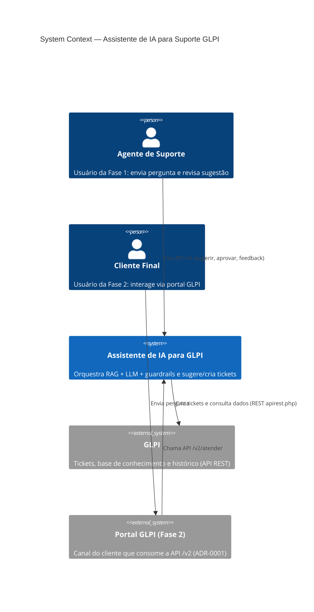
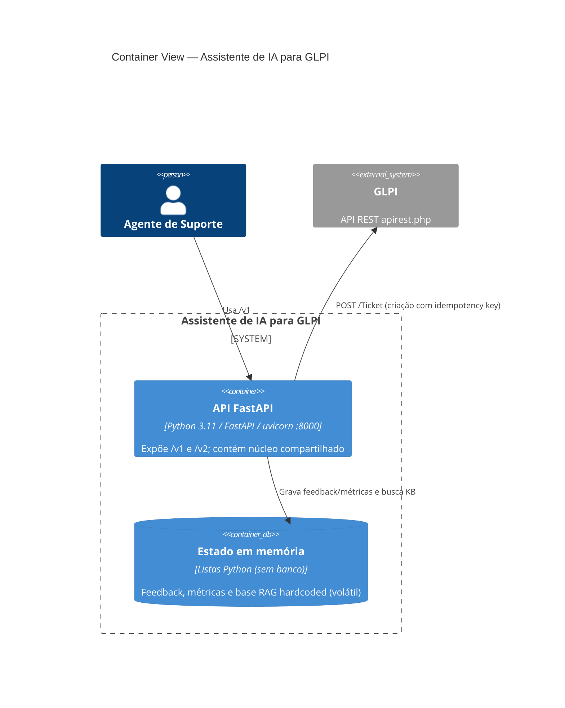
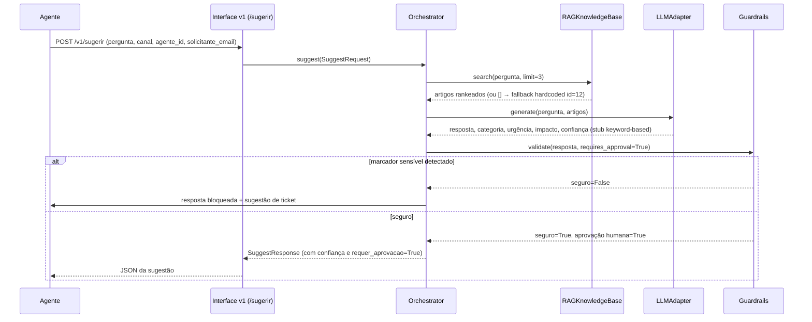
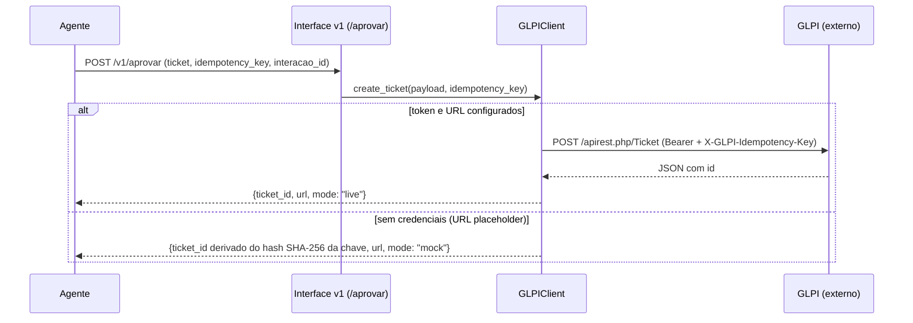
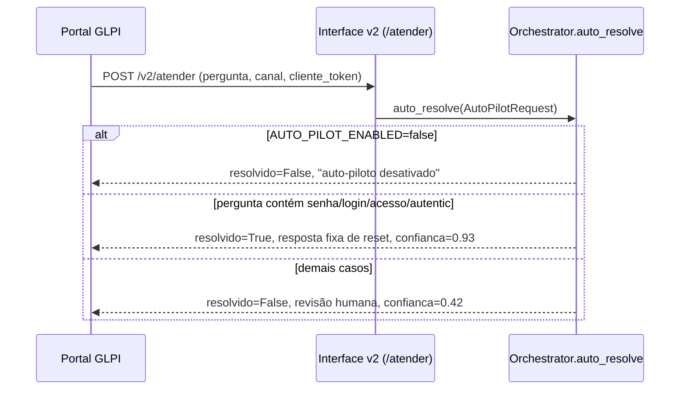
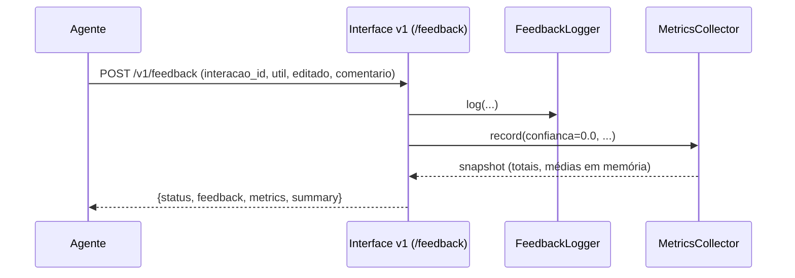
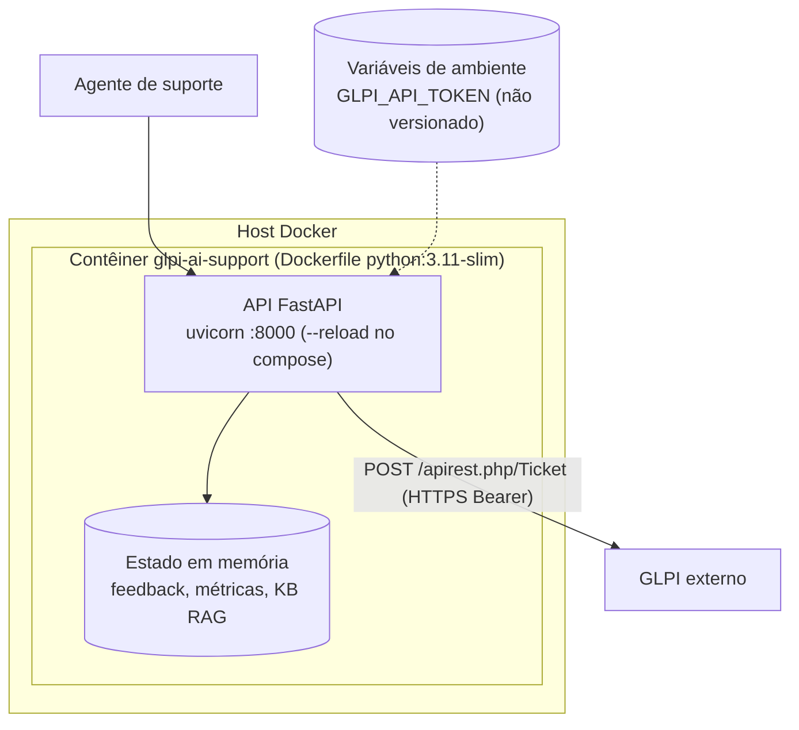

# Software Architecture Document: Assistente de IA para Suporte GLPI

## Purpose and Scope

Sistema de assistente de inteligência artificial para suporte no GLPI. O propósito é reduzir o tempo de primeira resposta do atendimento, aumentar a acurácia na classificação de categoria/urgência e reaproveitar a base de conhecimento do GLPI via RAG, mantendo supervisão humana no fluxo crítico.

**Escopo**: Fase 1 (apoio ao agente humano) é a prioridade. Fase 2 (autoatendimento do cliente) evolui do mesmo núcleo, exposta apenas como API para o portal GLPI (sem UI própria neste projeto — ver ADR-0001).

**Fronteira do sistema**: o projeto não altera o core do GLPI nem seu banco de dados; toda integração ocorre por REST (API do GLPI) através de um cliente único e centralizado (`core/glpi_client.py`).

**Fora de escopo**: UI própria web/mobile, treinamento de modelos, ingestão massiva de KB (planejada, não implementada), multi-tenant.

## Technical Context

**Language/Version**: Python 3.11+ (Dockerfile usa `python:3.11-slim`) 
**Primary Dependencies**: FastAPI, Pydantic, uvicorn, httpx, python-dotenv 
**Storage**: N/A — sem banco de dados próprio; feedback e métricas em memória (`feedback/logger.py`, `feedback/metrics.py`); estado perdido a cada reinício 
**Testing**: pytest (`tests/` — 8 arquivos: test_llm, test_health, test_guardrails, test_glpi_client, test_feedback, test_rag, test_orchestrator, test_v2_client_api) 
**Target Platform**: Servidor Docker (container único), exposto na porta 8000 via uvicorn 
**Project Type**: single service (modular monolith com núcleo compartilhado entre fases) 
**Performance Goals**: latência aceitável para suporte em tempo real (meta não formalizada com SLA numérico) 
**Constraints**: não alterar core/banco do GLPI; LLM local como requisito inicial (Ollama preferencial); credenciais fora do código (`.env` local, `.env_default` versionado como referência); human-in-the-loop obrigatório para criação de ticket na Fase 1 
**Scale/Scope**: suporte interno de helpdesk; volume de usuários e tickets não especificado; implantação single-instance (sem HA definida)

## System Decomposition

| Boundary | Responsibilities | Data Ownership | Exposed Interfaces | Dependencies | Deployment Independence |
|----------|------------------|----------------|--------------------|--------------|-------------------------|
| Interface Fase 1 (`interfaces/v1_agent_api.py`) | Endpoints `/v1/sugerir`, `/v1/aprovar`, `/v1/feedback`, `/v1/auto-piloto`, `/v1/atender` | N/A | HTTP REST (FastAPI) | Orchestrator, GLPIClient, FeedbackLogger, MetricsCollector | In-process (mesmo app) |
| Interface Fase 2 (`interfaces/v2_client_api.py`) | Endpoint `/v2/atender` para portal GLPI | N/A | HTTP REST (FastAPI) | Orchestrator | In-process (mesmo app) |
| Orquestração (`core/orchestrator.py`) | Coordena suggest e auto_resolve; classifica por keyword; monta sugestão de ticket | N/A | Chamadas em processo (classes Python) | RAG, LLMAdapter, Guardrails, Settings | In-process |
| RAG (`core/rag.py`) | Busca por palavras-chave sobre base hardcoded de 3 artigos | Base em memória (`KnowledgeArticle` fixa no código) | Método `search()` | N/A | In-process |
| LLM Adapter (`core/llm.py`) | Gera resposta/categoria/urgência/confiança | N/A | Método `generate()` | N/A | In-process |
| Guardrails (`core/guardrails.py`) | Valida resposta por marcadores sensíveis; sinaliza aprovação humana | N/A | Método `validate()` | N/A | In-process |
| GLPI Client (`core/glpi_client.py`) | Criação de ticket REST com fallback mock determinístico | N/A | HTTP → GLPI `apirest.php` | GLPI (externo), Settings | Acoplado ao GLPI externo |
| Feedback (`feedback/logger.py`, `feedback/metrics.py`) | Registro de feedback e métricas agregadas | Eventos em memória | Métodos `log()`, `record()`, `snapshot()` | N/A | In-process (não persiste) |
| Config (`config/settings.py`) | Carrega `.env` ou `.env_default`; expõe Settings | N/A | Import em processo | Env vars | In-process |

## System Scope and Context

**Usuários primários**: agente humano do suporte GLPI (Fase 1); cliente final via portal GLPI (Fase 2, futuro consumo da API).

**Sistemas externos**: GLPI (API REST `apirest.php` — tickets, futuramente KB/histórico); provedor LLM (Ollama local preferencial; OpenAI/Anthropic/Gemini como opções futuras — nenhum integrado hoje).

**Fronteiras de confiança**: o assistente opera como serviço interno confiável; o GLPI é sistema de registro de tickets (somente escrita via API); o cliente final da Fase 2 acessa via portal GLPI, não diretamente o assistente (ADR-0001).

**Exclusões**: UI própria, edição do core do GLPI, automação sem supervisão humana na Fase 1.

### C4 System Context

### C4 Container View

## Architecture View Catalog

| View | Concern | Scope | Notation | Rationale |
|------|---------|-------|----------|-----------|
| System Context | Atores e dependências externas | Whole system | C4 Context | Visão obrigatória das fases e fronteiras |
| Container View | Fronteiras de runtime e dados | Whole system | C4 Container | Visão obrigatória do serviço único e estado em memória |
| Fluxo Fase 1 (sugerir→aprovar) | Sequência temporal humano-no-loop | Núcleo + interfaces v1 | Sequence | Regra crítica: aprovação humana antes de criar ticket |
| Fluxo Fase 2 (auto-piloto) | Decisão automática sob guardrails | Núcleo + interfaces v2 | Sequence | Expor risco atual: guardrails não aplicados neste caminho |

## Solution Strategy and Architecture Style

- **Architecture Style**: Modular monolith — serviço único FastAPI com módulos internos desacoplados (interface, orquestração, RAG, LLM, guardrails, GLPI client, feedback).
- **Source Code Layout**: Brownfield preservado: `core/` (orchestrator, rag, llm, guardrails, glpi_client, schemas), `interfaces/` (v1_agent_api, v2_client_api), `feedback/` (logger, metrics), `config/` (settings), `tests/`, `main.py`.
- **Why this style fits**: Fase 1 e Fase 2 compartilham o mesmo núcleo (princípio central da arquitetura); baixo volume inicial e requisito de iteração rápida favorecem processo único sem complexidade de microsserviços.
- **Alternatives considered**: microsserviços por fase — rejeitado por duplicar lógica e contrariar o princípio de núcleo compartilhado; reescrita sobre o core do GLPI — rejeitada por restrição de não alterar o GLPI.

## Major Data Flow Catalog

| Flow ID | Trigger | Source / Actor | Processing Boundaries | Stores | Egress | Trust / Data Class | Consistency / Transaction | Failure / Recovery | Diagram |
|---------|---------|----------------|-----------------------|--------|--------|--------------------|---------------------------|--------------------|---------|
| FLOW-001 | POST /v1/sugerir | Agente | Interface v1 → Orchestrator → RAG → LLM → Guardrails | N/A (leitura da base RAG em memória) | Resposta JSON com sugestão + ticket_sugerido | Confiança: interna; dados de solicitante (e-mail) | Sem transação; sugestão apenas | Guardrail bloqueia → resposta de segurança substitui sugestão | FLOW-001 |
| FLOW-002 | POST /v1/aprovar | Agente | Interface v1 → GLPIClient.create_ticket | N/A | POST GLPI /Ticket ou mock determinístico | Confiança: escrita no GLPI (sistema de registro) | Idempotência por `X-GLPI-Idempotency-Key` (cliente); mock deriva ticket_id do hash da chave | GLPI indisponível → httpx raise (sem retry); sem token/URL placeholder → modo mock | FLOW-002 |
| FLOW-003 | POST /v2/atender (e /v1/auto-piloto) | Portal GLPI / cliente | Interface → Orchestrator.auto_resolve (keyword: senha/login/acesso) | N/A | Resposta JSON | Confiança: saída ao cliente final | Sem transação | AUTO_PILOT_ENABLED=false → recusa com mensagem | FLOW-003 |
| FLOW-004 | POST /v1/feedback | Agente | Interface v1 → FeedbackLogger + MetricsCollector | Eventos em memória | JSON com snapshot de métricas | Confiança: métricas de qualidade | Sem persistência | Reinício do processo perde todo o histórico | FLOW-004 |

## Major Data Flow Diagrams

### FLOW-001: Sugestão ao agente (Fase 1)

[Regra crítica da Fase 1: criação de ticket nunca é automática — exige `POST /v1/aprovar` com `idempotency_key` após revisão humana.]

### FLOW-002: Aprovação e criação de ticket

[Obs.: `interacao_id` é aceito no payload mas não é correlacionado nem persistido pelo cliente; idempotência real no GLPI depende de o header ser honorado pelo GLPI, o que não é garantido pelo core do produto.]

### FLOW-003: Auto-piloto / atendimento (Fase 2)

[Esta implementação atual não consulta RAG, LLM nem Guardrails — caminho simplificado por keyword. `cliente_token` é aceito sem validação.]

### FLOW-004: Feedback e métricas

## Additional Architecture Views

- **Núcleo compartilhado Fase 1/Fase 2**: a mesma classe `Orchestrator` serve ambos os routers (`v1_agent_api.py` e `v2_client_api.py` instanciam `Orchestrator()`). A diferenciação entre fases é de interface e política, não de duplicação de núcleo — princípio confirmado no código atual.
- **Camada de configuração**: `config/settings.py` carrega `.env` se existir, senão `.env_default`; variáveis: APP_NAME, APP_VERSION, APP_ENVIRONMENT, GLPI_BASE_URL, GLPI_API_TOKEN, AUTO_PILOT_ENABLED. Nenhum segredo versionado no repositório.

## Deployment and Trust Topology

O que existe de deployment hoje:

- `Dockerfile`: imagem `python:3.11-slim`, instala `requirements.txt`, expõe 8000, CMD uvicorn `main:app` em 0.0.0.0:8000.
- `docker-compose.yml`: serviço único `glpi-ai-support`, porta mapeada `8000:8000`, volume `.:/app`, comando uvicorn com `--reload` (modo dev).
- Configuração por variáveis de ambiente via `.env` (local, não versionado) e `.env_default` (referência versionada).

Não existe: orquestrador de clusters, balanceamento, banco externo, cache, filas, TLS terminated no próprio serviço, pipeline de deploy ou múltiplos ambientes automatizados. Detalhes de runtime operacional ficam para o DOD/deployment design.

## Cross-Cutting Concerns

### Security

- **Segredos**: `GLPI_API_TOKEN` e `GLPI_BASE_URL` via env vars (`.env` local fora do controle de versão; `.env_default` como referência). Sem credenciais hardcoded no código-fonte.
- **Autenticação/autorização**: não implementada — endpoints `/v1` e `/v2` estão abertos; `cliente_token` do `AutoPilotRequest` é aceito mas nunca validado. Identificação do agente (`agente_id`) vem do payload sem verificação. Tratado como lacuna crítica (ver Open Questions).
- **Guardrails**: camada central por design; implementação atual baseada em lista de marcadores por substring (`core/guardrails.py`), aplicada apenas em `suggest()`. **Não invocada em `auto_resolve()`** — divergência relevante de segurança para o caminho de autoatendimento.
- **Human-in-the-loop**: `requer_aprovacao=True` fixo na Fase 1; criação de ticket somente via `/v1/aprovar`.
- **Dados sensíveis**: não há filtro estruturado de PII; o guardrail atual só bloqueia ações sensíveis por marcadores de texto.

### Reliability

- Sem SLA formal; serviço single-instance sem HA/failover.
- GLPI indisponível: `httpx.post` propaga exceção (`raise_for_status`), sem retry/backoff/circuit breaker.
- Fallback mock no `GLPIClient` quando token ausente ou URL placeholder — evita falha em dev, mas pode mascarar erro de configuração em produção (mode="mock" no retorno).
- Idempotência de criação: chave enviada como header customizado; no modo mock o `ticket_id` é derivado deterministicamente do SHA-256 da `idempotency_key` (mesma chave → mesmo id).
- Estado de feedback/métricas é volátil (memória) — reinício perde histórico.

### Observability

- Sem logging estruturado, tracing ou métricas exportadas (Prometheus etc.).
- `FeedbackLogger` e `MetricsCollector` mantêm eventos em listas em memória; `snapshot()` expõe agregados (total, positivos, editados, confiança média, latência média — latência nunca populada hoje).
- Auditoria completa de interações prevista na especificação; não implementada (interações de sugestão não são registradas, apenas feedback explícito).
- `/health` endpoint simples para liveness.

### Data Management

- Sem banco de dados próprio. Base RAG é hardcoded em `core/rag.py` (3 artigos de exemplo) — não sincroniza com a base de conhecimento do GLPI.
- Dados de tickets vivem no GLPI (sistema de registro). O assistente só escreve via criação.
- Retenção, backup e residência de dados: não aplicáveis hoje (sem persistência); serão relevantes quando feedback/métricas ganharem armazenamento durável.

### Integration Strategy

- Protocolo: REST sobre HTTPS contra a API do GLPI (`apirest.php`), encapsulado exclusivamente em `core/glpi_client.py` (wrapper único — princípio de compatibilidade com GLPI).
- Contratos internos: modelos Pydantic (`core/schemas.py`) — SuggestRequest/Response, ApprovalRequest, FeedbackRequest, AutoPilotRequest/Response.
- Versionamento de API: prefixos `/v1` e `/v2` no FastAPI.
- Sem eventos/assincronismo; integrações síncronas com timeout de 10s no GLPI.
- Integração com provedores LLM: nenhuma implementada — `LLMAdapter` é stub determinístico por keyword; a abstração existe para isolar o provedor quando Ollama/OpenAI/etc. forem plugados.

### Operations

- Ambiente único de execução (development por padrão via APP_ENVIRONMENT).
- Operação local via `uvicorn main:app --port 8000` ou `docker compose up` (com `--reload`).
- Release: promoção `dev` → `main` apenas com autorização explícita (regra do projeto); versionamento centralizado em `APP_VERSION` (hoje 0.1.0 em `.env_default`).
- Sem ambientes staging/prod formalizados nem pipeline de deploy automatizado. Handoff operacional detalhado fica para o DOD.

## Quality Attributes

| Attribute | Target | Measurement | Architectural Response |
|-----------|--------|-------------|------------------------|
| Performance | Latência aceitável para atendimento em tempo real (sem SLA numérico definido) | Ainda não medida (campo `latency_ms` existe mas não é populado) | Pipeline síncrono em memória; busca RAG leve por keywords |
| Reliability | Operação contínua em horário comercial; sem duplicação de tickets | Healthcheck `/health`; modo mock em dev | Idempotency key na criação; fallback mock (com risco de mascarar erro) |
| Security | Human-in-the-loop obrigatório; sem segredos no repo; respostas sensíveis bloqueadas | Guardrails + revisão de Aprovação; varredura de `.env` fora do VCS | Guardrails antes de `/aprovar`; env vars; marcadores de ação sensível |
| Maintainability | Núcleo compartilhado sem duplicação entre fases; troca de LLM sem reescrita | Estrutura de módulos + testes pytest em todos os módulos | Adapter pattern (LLMAdapter, GLPIClient); schemas Pydantic centralizados |
| Scalability | Suficiente para volume atual de helpdesk single-instance | Não avaliada | Sem arquitetura horizontal hoje; estado em memória impede escala horizontal |

## Architecture Traceability

| Capability / Objective | Boundary | Major Flow | Quality Target | ADRs |
|------------------------|----------|------------|----------------|------|
| Reduzir tempo de primeira resposta | Interface v1 + Orchestrator | FLOW-001 | Performance | N/A |
| Classificação com supervisão humana | Orchestrator + Guardrails | FLOW-001, FLOW-002 | Security (human-in-the-loop) | N/A |
| Integração segura com GLPI | GLPIClient | FLOW-002 | Reliability (idempotência) | N/A |
| Autoatendimento via portal (Fase 2) | Interface v2 + Orchestrator | FLOW-003 | Security (guardrails rígidos) | ADR-0001 |
| Melhoria orientada a dados | Feedback/Metrics | FLOW-004 | Maintainability | N/A |
| Gestão de evolução via SDDP | Projeto inteiro | N/A | Maintainability | ADR-0002 |

## Architecture Decision Records

Decisões arquiteturais de projeto são mantidas como arquivos MADR independentes sob `specs/adrs/`. Esta tabela é um índice de navegação; os registros completos vivem nos arquivos vinculados.

| ADR ID | Title | Status | Date | Supersedes | File |
|--------|-------|--------|------|------------|------|
| ADR-0001 | Fase 2 via portal GLPI consumindo API própria (sem UI própria no projeto) | accepted | 2026-10-30 | - | [0001-fase-2-via-portal-glpi.md](adrs/0001-fase-2-via-portal-glpi.md) |
| ADR-0002 | Adoção do framework SDDP (transplantado de ../inhome) substituindo o modelo SP1–SP11 de docs/spec + docs/plan | accepted | 2026-10-30 | - | [0002-adocao-framework-sddp.md](adrs/0002-adocao-framework-sddp.md) |

<!-- Linhas gerenciadas pelo subagente ADR Author. Não embutir prosa completa das decisões aqui. -->

Resumo de contexto (não substitui o registro MADR):

- **ADR-0001** — Decisão de produto: a Fase 2 não terá interface/UI própria neste projeto. O atendimento automatizado será exposto como API (`/v2/atender`) consumida pelo portal GLPI já existente. Reduz escopo de frontend e mantê o cliente no canal oficial.
- **ADR-0002** — Decisão de processo: o projeto adota o framework SDDP (transplantado de `../inhome`), com workflow de System Design e artefatos em `specs/`, substituindo o modelo de fases SP1–SP11 centrado em `docs/spec` + `docs/plan`. Os documentos legados em `docs/spec/` permanecem como referência histórica e fonte migrada deste SAD.

## Risks, Assumptions, Constraints, and Open Questions

### Risks

- **Guardrails não aplicados no auto-piloto**: `auto_resolve()` ignora a camada de guardrails — risco de resposta inadequada ao cliente final se `/v2` for exposta sem endurecer o fluxo.
- **Ausência de autenticação/autorização**: APIs abertas permitem qualquer chamador supor-se agente ou cliente; `cliente_token` não validado.
- **Estado volátil**: sem persistência de feedback/métricas, métricas de melhoria contínua são perdidas a cada reinício — compromete objetivo de orientação por dados.
- **Stub de LLM e RAG por keyword**: qualidade de resposta depende de regras rígidas; troca real por provedor LLM e KB semântica envolve reescrever adapters atuais (interfaces já desacoplam o impacto).
- **Fallback mock do GLPI**: pode criar "tickets" fictícios silenciosamente se configuração de produção falhar por engano.
- **Idempotência dependente do GLPI**: header `X-GLPI-Idempotency-Key` não é garantia no core do GLPI; duplicação possível sob reenvio se o servidor não honrar o header.

### Assumptions

- GLPI permanece sistema de registro canônico de tickets e KB; o assistente não substitui banco próprio.
- Fase 1 antecede a Fase 2; o núcleo atual evolui sem reescrita.
- LLM local (Ollama) é preferencial na Fase 1 por soberania de dados.
- O portal GLPI consome a API `/v2` como único canal da Fase 2 (ADR-0001).

### Constraints

- Não alterar o core do GLPI nem seu banco de dados.
- Todo desenvolvimento no branch `dev`; promoção a `main` apenas com autorização explícita.
- `.env` fora do versionamento; `.env_default` mantido como referência versionada.
- Criação de ticket na Fase 1 exige aprovação humana (regra crítica).
- Versão centralizada (`APP_VERSION`), formato `vx.x.x`, incrementada na promoção a produção.

### Open Questions

- Qual mecanismo de autenticação/autorização será adotado para `/v1` (agente) e `/v2` (portal)?
- Qual armazenamento durável para feedback, métricas e auditoria (banco relacional, SQLite, etc.)?
- Quando e como substituir o stub keyword do LLMAdapter pelo primeiro provedor real (Ollama)?
- Qual o destino da ingestão da base de conhecimento real do GLPI para o RAG (scripts/ingest_kb.py planejado na estrutura, ainda inexistente)?
- O GLPI honra o header `X-GLPI-Idempotency-Key` ou a idempotência deve ser resolvida no cliente?

## Project Context Baseline Updates

- **Stack validada no brownfield**: Python 3.11 (Docker), FastAPI, Pydantic, uvicorn, httpx, pytest — mantida como baseline técnica até nova decisão.
- **Layout de módulos brownfield**: `core/`, `interfaces/`, `feedback/`, `config/`, `tests/`, `main.py` — espelha a estrutura proposta na arquitetura documentada (`docs/spec/Arquitetura do Sistema`), com lacunas: `config/prompts/`, `config/guardrails.yaml` e `scripts/ingest_kb.py` planejados mas ainda inexistentes.
- **Modelo de decisão migrado**: framework SDDP (ADR-0002) substitui o ciclo SP1–SP11; este SAD consolida as decisões de `docs/spec/Arquitetura do Sistema — Assistente de IA para GLPI.md` e `docs/spec/Documento Técnico — Funcionamento da Solução.md` com o estado real do código.
